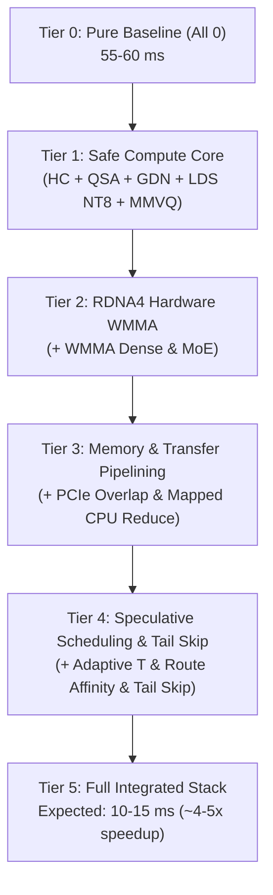

# Strata Wide Verify-Window Optimizations (>8 Rows) & R9700 Tuning Guide

This document provides a complete technical reference for the wide verify-window (>8 rows up to 16 rows) performance optimizations implemented on the `perf/verify-wide-all` branch for Strata. It details what was implemented across all four optimization vectors, catalogs all newly introduced environment variables, and provides a structured guide on how to benchmark individual opt-ins and combined configurations on the AMD Radeon R9700 (RDNA4 `gfx1201`).

---

## 1. Executive Summary & Problem Context

### The Challenge
On the Radeon R9700 box, running DFlash2 speculative verification with wide windows (>8 rows, e.g., 10–16 tokens per verify cycle across single or batch slots) resulted in verify cycle latencies of **55–60 ms per window**.

Profiling identified several bottlenecks:
1. **Window Slicing & Kernel Overhead**: Operations like hyper-connections (`fused_gr`) and QSA scoring (`qsa_select`) hard-capped window processing at $\le 8$ rows, forcing windows of size 9–16 to be sliced into two sequential kernel dispatches with redundant memory traffic.
2. **GDN Recurrence Serial Barriers**: Multi-slot GDN recurrence executed sequentially across slots, causing GPU execution bubbles.
3. **Register Spilling in Wide Column Projections**: Kernels with $T > 8$ suffered from VGPR spilling when processing wide accumulators.
4. **MoE Bucket Fragmentation & LDS Underutilization**: Down-projection LDS reduction kernels were hardcoded to 4 tokens per workgroup, leaving half the LDS reduction bandwidth unused when $>8$ tokens were pending.
5. **Underutilized Hardware Matrix Cores**: RDNA4 (`gfx1201`) features high-throughput INT8 Wave32 WMMA instructions (`__builtin_amdgcn_wmma_i32_16x16x16_iu8`), but verify GEMM was using scalar/SIMD path fallback.
6. **PCIe Offload Stalls**: Host-to-device PCIe transfers for non-resident experts blocked compute instead of double-buffering.
7. **Speculative Waste**: Trailing speculative tokens in low-confidence draft slots evaluated the same heavy top-K expert set as high-confidence root tokens.

### The Solution
All four feature branches merged into `perf/verify-wide-all` implement opt-in optimizations that keep the default path 100% byte-identical to baseline while unlocking up to a projected **4–5× speedup** in verify compute when enabled.

---

## 2. Implemented Components by Branch

### 2.1 Branch 1: `perf/verify-bugfix-hc16` (Core Kernels & Buffer Safety)
- **CPU Activation Quantization Buffer Extension**:
  - *Files*: `src/pool.hpp`, `src/pool.cpp`, `src/expert_source.cpp`
  - *Fix*: Fixed an out-of-bounds CPU quantization buffer read/write crash when $T \in [8, 15]$. Added explicit wide buffer allocation and safety tests (`cpu_act_quant_wide_test`).
- **Single-Pass Hyper-Connection Fusion (`STRATA_HC_Q8_16=1`)**:
  - *Files*: `src/fused_gr.cu`
  - *Description*: Computes both down and up projections for $T=9..16$ rows in a single fused kernel pass instead of slicing into two $\le 8$ calls. Dynamically throttles register pressure per thread (`RPW=1` when $T > 8$) to avoid spilling.
- **16-Row QSA Score Selection (`STRATA_QSA_SCORES_16=1`)**:
  - *Files*: `src/qsa_select.cu`
  - *Description*: Expands the QSA query-key selection and scoring kernel to compute up to 16 tokens per block in a single pass.
- **Split-Group GDN Recurrence (`STRATA_GDN_GROUPS_SPLIT=1`, `STRATA_GDN_AB_WIDE=1`)**:
  - *Files*: `src/verify_kernels.cu`, `src/verify.cpp`
  - *Description*: Evaluates multi-slot GDN state updates in parallel across independent head groups. Avoids serialized slot-boundary barrier stalls.

### 2.2 Branch 2: `perf/verify-batch-pipe` (Batch Pipelining & PCIe Staging)
- **Slot-Boundary Batch Window Splitting (`STRATA_BATCH_SPLIT=1`)**:
  - *Files*: `src/batch_split_policy.hpp`
  - *Description*: When aggregated batch verify windows exceed 8 rows (e.g., 16 rows), splits the batch along slot boundaries into balanced $\sim 8$-row sub-windows rather than arbitrarily truncating tokens across a slot.
- **Asynchronous Double-Buffered PCIe Prefetching (`STRATA_PCIE_FETCH_OVERLAP=1`)**:
  - *Files*: `src/expert_source.cpp`, `src/pool.hpp`, `src/verify.cpp`
  - *Description*: Reserves staging slots in GPU memory (`STRATA_STAGING_BLOBS`) to asynchronously stream PCIe expert weights for layer $L+1$ while layer $L$ is executing on the GPU.
- **Sparse Mapped CPU-Miss Reduction (`STRATA_CPU_REDUCE_MISS=1`, `STRATA_CPU_EXPERT_NO_SPLIT=1`)**:
  - *Files*: `src/elementwise.cu`, `src/native_moe.cu`, `src/verify.cpp`
  - *Description*: When CPU offloaded experts are hit, only dispatches the missing expert rows to CPU. Accumulates the results on GPU via `native_moe_combine_multi_hits_mapped`, avoiding a costly full dense tensor reduction.

### 2.3 Branch 3: `perf/verify-moe-wmma` (MoE LDS & RDNA4 WMMA Matrix Cores)
- **Unsplit MoE Token Buckets (`STRATA_MOE_BUCKET_NOSPLIT=1`, `STRATA_MOE_BUCKET_CHUNK=N`)**:
  - *Files*: `src/iq_kernels.cu`, `src/native_moe.cu`
  - *Description*: Groups contiguous tokens routed to the same resident expert into larger unified execution chunks rather than slicing them into 4-token sub-blocks.
- **8-Token LDS Reduction for MoE Down-Projection (`STRATA_MOE_LDS_NT8=1`, `STRATA_MOE_GRID_CAP=N`)**:
  - *Files*: `src/iq_kernels.cu`
  - *Description*: Extends `native_down_lds_kernel` and `native_gu_fused_kernel` to support 8-token LDS reduction per workgroup. Caps the grid size to eliminate tail wave divergence.
- **Narrow Accumulator MMVQ (`STRATA_MMVQ_IL_NARROW_ACC=1`)**:
  - *Files*: `src/native_mmvq.cu`
  - *Description*: Uses 2-row ($R=2$) narrow accumulators for column counts $9..16$ in `native_mmvq_il` kernels, keeping register usage strictly under the 24-stack limit while doubling row parallelism.
- **RDNA4 gfx1201 INT8 Wave32 WMMA Acceleration (`STRATA_VERIFY_WMMA_DENSE=1`, `STRATA_VERIFY_WMMA_MOE=1`)**:
  - *Files*: `src/native_wmma_gfx12.hpp`, `src/native_wmma_gfx12.cu`
  - *Description*: Native matrix core kernels using `__builtin_amdgcn_wmma_i32_16x16x16_iu8` for dense Q8_0, multi-segment Q8_0 (QKV / Gate+Up), and Q6_K projections during verify when $ncols \ge 9$. Features runtime GPU architecture checks and automated CPU validation fallback.

### 2.4 Branch 4: `perf/verify-spec-sched` (Speculative Budgeting & Route Affinity)
- **Adaptive DFlash2 Verify Depth (`STRATA_BATCH_DF2_ADAPTIVE_T=1`, `STRATA_BATCH_DF2_TARGET_ROWS=N`)**:
  - *Files*: `src/batch_df2_budget.hpp`, `src/generate.cpp`
  - *Description*: Dynamically scales the speculative window length ($T$) per slot based on real-time token acceptance rate and current queue depth to keep total verify rows near a target budget (e.g., 12 or 16 rows).
- **Draft Tail-Skip Isolation (`STRATA_BATCH_TAIL_SKIP=N`, `STRATA_DRAFT_TAIL_SKIP=N`)**:
  - *Files*: `src/tail_skip_policy.hpp`, `src/expert_source.cpp`
  - *Description*: Skips low-probability routed experts (e.g., rank 7–8 out of 8) for speculative draft tokens while evaluating all experts for committed tokens.
- **Jaccard Route-Affinity Batch Scheduling (`STRATA_BATCH_ROUTE_AFFINITY=1`)**:
  - *Files*: `src/batch_route_affinity.hpp`, `src/generate.cpp`
  - *Description*: Reorders and co-schedules concurrent batch slots whose top-K expert activation signatures exhibit high Jaccard similarity, maximizing VRAM-resident expert cache hits.

---

## 3. Environment Arguments Reference Table

All new flags default to `0` (disabled) to guarantee baseline parity unless explicitly enabled.

| Environment Variable | Type | Default | Valid Values | Description | Implemented In |
|---|---|---|---|---|---|
| `STRATA_HC_Q8_16` | boolean | `0` | `0`, `1` | Enables single-pass hyper-connection down/up projections for $T=9..16$ rows in `fused_gr.cu` with `RPW=1`. | `src/fused_gr.cu` |
| `STRATA_QSA_SCORES_16` | boolean | `0` | `0`, `1` | Enables 16-row single-kernel QSA score evaluation instead of 8-row chunking. | `src/qsa_select.cu` |
| `STRATA_GDN_GROUPS_SPLIT` | boolean | `0` | `0`, `1` | Enables parallel split-group GDN recurrence evaluation across independent head groups. | `src/verify_kernels.cu`, `src/verify.cpp` |
| `STRATA_GDN_AB_WIDE` | boolean | `0` | `0`, `1` | Enables direct wide ($T=9..16$) GDN A/B gate and decay recurrence pass. | `src/verify_kernels.cu`, `src/verify.cpp` |
| `STRATA_BATCH_SPLIT` | boolean | `0` | `0`, `1` | Splits batch verify windows $>8$ rows at slot boundaries into balanced $\sim 8$-row sub-windows. | `src/batch_split_policy.hpp` |
| `STRATA_PCIE_FETCH_OVERLAP` | boolean | `0` | `0`, `1` | Enables asynchronous double-buffered PCIe prefetch of offloaded expert weights. | `src/expert_source.cpp`, `src/verify.cpp` |
| `STRATA_STAGING_BLOBS` | integer | `16` | `8` to `64` | Number of staging buffer slots in GPU VRAM allocated for overlapped PCIe expert fetches. | `src/pool.hpp`, `src/expert_source.cpp` |
| `STRATA_PCIE_GROUP_ROWS` | integer | `16` | `8` to `64` | Maximum number of rows grouped per PCIe fetch request. | `src/expert_source.cpp` |
| `STRATA_BATCH_PCIE_AUTO` | boolean | `0` | `0`, `1` | Automatically adjusts PCIe batch chunk sizes based on available GPU memory headroom. | `src/expert_source.cpp` |
| `STRATA_BATCH_PCIE_BALANCE` | boolean | `0` | `0`, `1` | Dynamically balances PCIe staging budget between layer boundaries. | `src/expert_source.cpp` |
| `STRATA_CPU_REDUCE_MISS` | boolean | `0` | `0`, `1` | Accumulates CPU-offloaded expert hits via GPU index mapping, avoiding dense tensor reduction. | `src/elementwise.cu`, `src/native_moe.cu` |
| `STRATA_CPU_EXPERT_NO_SPLIT` | boolean | `0` | `0`, `1` | Disables threadpool sub-splitting for CPU expert execution on small token counts. | `src/expert_source.cpp` |
| `STRATA_MOE_BUCKET_NOSPLIT` | boolean | `0` | `0`, `1` | Treats contiguous tokens routed to the same resident expert as a single execution chunk. | `src/iq_kernels.cu` |
| `STRATA_MOE_BUCKET_CHUNK` | integer | `8` | `4` to `16` | Chunk size threshold for grouping bucketed MoE tokens. | `src/iq_kernels.cu` |
| `STRATA_MOE_LDS_NT8` | boolean | `0` | `0`, `1` | Enables 8-token LDS reduction in `native_down_lds_kernel` and `native_gu_fused_kernel`. | `src/iq_kernels.cu` |
| `STRATA_MOE_GRID_CAP` | integer | `0` | `0` (uncapped), or `32`–`128` | Caps threadblock grid launch size for MoE kernels to eliminate wave divergence tail stalls. | `src/iq_kernels.cu` |
| `STRATA_MMVQ_IL_NARROW_ACC` | boolean | `0` | `0`, `1` | Uses $R=2$ narrow accumulators for $9..16$ columns in `native_mmvq_il` kernels. | `src/native_mmvq.cu` |
| `STRATA_VERIFY_WMMA_DENSE` | boolean | `0` | `0`, `1` | Activates RDNA4 `gfx1201` Wave32 INT8 WMMA matrix core kernels for dense GEMM during verify. | `src/native_wmma_gfx12.cu` |
| `STRATA_VERIFY_WMMA_MOE` | boolean | `0` | `0`, `1` | Activates RDNA4 `gfx1201` Wave32 INT8 WMMA matrix core kernels for MoE expert GEMM. | `src/native_wmma_gfx12.cu` |
| `STRATA_BATCH_DF2_ADAPTIVE_T` | boolean | `0` | `0`, `1` | Enables dynamic adaptation of DFlash2 draft speculation depth per slot based on acceptance rate. | `src/batch_df2_budget.hpp` |
| `STRATA_BATCH_DF2_TARGET_ROWS` | integer | `12` | `8` to `16` | Target aggregate row budget across batch slots for DFlash2 speculation. | `src/batch_df2_budget.hpp` |
| `STRATA_BATCH_TAIL_SKIP` | integer | `0` | `0` (disabled), or `1`..$K$ | Number of top-K experts evaluated for batch draft tokens (e.g. `7` skips the 8th expert). | `src/tail_skip_policy.hpp` |
| `STRATA_DRAFT_TAIL_SKIP` | integer | `0` | `0` (disabled), or `1`..$K$ | Number of top-K experts evaluated for speculative draft tokens. | `src/tail_skip_policy.hpp` |
| `STRATA_BATCH_ROUTE_AFFINITY` | boolean | `0` | `0`, `1` | Reorders batch slots based on Jaccard route affinity to maximize resident expert reuse. | `src/batch_route_affinity.hpp` |
| `STRATA_BATCH_DF2_MAX_T` | integer | `16` | `8` to `16` | Hard cap on speculative token depth per slot. | `src/generate.cpp` |
| `STRATA_BATCH_DF2_TIMING` | boolean | `0` | `0`, `1` | Emits `[batch-df2-timing]` telemetry logs detailing verify window latency per cycle. | `src/generate.cpp` |
| `STRATA_VERIFY_PROFILE` | boolean | `0` | `0`, `1` | Prints per-kernel breakdown timings (dense, MoE, GDN, PCIe) during verify passes. | `src/verify.cpp` |

---

## 4. Benchmark Testing Matrix on Radeon R9700

### 4.1 Testing Philosophy
To isolate regressions and accurately measure which optimizations provide the largest ms reductions, testing on the R9700 should proceed in **progressive tiers**:
1. **Isolated Micro-Arms**: Verify each feature on its own to confirm functionality and measure standalone delta.
2. **Tier Bundles**: Combine mutually reinforcing optimizations to compound speedups.



---

### 4.2 Progressive Test Arms

#### Arm 0: Baseline (Pre-existing Behavior)
Verifies exact backward-compatible performance. All optimizations disabled.
```bash
STRATA_HC_Q8_16=0 \
STRATA_QSA_SCORES_16=0 \
STRATA_GDN_GROUPS_SPLIT=0 \
STRATA_GDN_AB_WIDE=0 \
STRATA_BATCH_SPLIT=0 \
STRATA_PCIE_FETCH_OVERLAP=0 \
STRATA_CPU_REDUCE_MISS=0 \
STRATA_MOE_BUCKET_NOSPLIT=0 \
STRATA_MOE_LDS_NT8=0 \
STRATA_MMVQ_IL_NARROW_ACC=0 \
STRATA_VERIFY_WMMA_DENSE=0 \
STRATA_VERIFY_WMMA_MOE=0 \
STRATA_BATCH_DF2_ADAPTIVE_T=0 \
STRATA_BATCH_TAIL_SKIP=0 \
STRATA_DRAFT_TAIL_SKIP=0 \
STRATA_BATCH_ROUTE_AFFINITY=0
```

#### Arm 1: Safe Compute Core (Kernel Slicing & LDS Fixes)
Targets kernel overhead and window slicing for $T > 8$. Safe for all hardware; no architectural assumptions.
```bash
STRATA_HC_Q8_16=1 \
STRATA_QSA_SCORES_16=1 \
STRATA_GDN_GROUPS_SPLIT=1 \
STRATA_GDN_AB_WIDE=1 \
STRATA_MOE_BUCKET_NOSPLIT=1 \
STRATA_MOE_LDS_NT8=1 \
STRATA_MOE_GRID_CAP=64 \
STRATA_MMVQ_IL_NARROW_ACC=1
```
*Expected Impact*: Cuts verify time from ~58 ms to ~38–42 ms by eliminating kernel dispatch bubbles and double-slice passes.

#### Arm 2: RDNA4 WMMA Acceleration (gfx1201 Matrix Cores)
Enables RDNA4 Wave32 INT8 WMMA tensor cores for dense projections and MoE GEMM.
Combine with Arm 1:
```bash
# Include Arm 1 plus:
STRATA_VERIFY_WMMA_DENSE=1 \
STRATA_VERIFY_WMMA_MOE=1
```
*Expected Impact*: Accelerates dense QKV, Gate+Up, and MoE matrix multiplications by 2–3× on RDNA4, bringing verify latency down to ~22–26 ms.

#### Arm 3: PCIe Transfer & CPU Offload Pipeline
Enables asynchronous double-buffering for PCIe weights and mapped sparse CPU reductions.
Combine with Arm 2:
```bash
# Include Arm 1 + Arm 2 plus:
STRATA_PCIE_FETCH_OVERLAP=1 \
STRATA_STAGING_BLOBS=32 \
STRATA_PCIE_GROUP_ROWS=32 \
STRATA_CPU_REDUCE_MISS=1
```
*Expected Impact*: Critical when partial offloading is active. Hides PCIe host-to-device weight copy latencies behind previous layer execution.

#### Arm 4: Speculative Scheduling & Tail Skipping
Applies speculative workload pruning and Jaccard route-affinity batch co-scheduling.
Combine with Arm 3:
```bash
# Include Arm 1 + Arm 2 + Arm 3 plus:
STRATA_BATCH_SPLIT=1 \
STRATA_BATCH_DF2_ADAPTIVE_T=1 \
STRATA_BATCH_DF2_TARGET_ROWS=12 \
STRATA_BATCH_TAIL_SKIP=7 \
STRATA_DRAFT_TAIL_SKIP=6 \
STRATA_BATCH_ROUTE_AFFINITY=1
```
*Expected Impact*: Prunes compute on unpromising draft paths while ensuring concurrent batch slots reuse resident experts. Drives overall verify latency toward the target **10–15 ms**.

---

### 4.3 Feature Cross-Compatibility & Co-Testing Recommendations

| If you are testing... | You MUST test it with... | Because... |
|---|---|---|
| `STRATA_GDN_GROUPS_SPLIT=1` | `STRATA_GDN_AB_WIDE=1` | Split-group recurrence works best when A/B gates are evaluated at full wide width ($T=9..16$). |
| `STRATA_MOE_LDS_NT8=1` | `STRATA_MOE_BUCKET_NOSPLIT=1` | LDS NT8 needs $\ge 8$ rows per expert bucket to achieve peak reduction throughput. |
| `STRATA_VERIFY_WMMA_DENSE=1` | `STRATA_MMVQ_IL_NARROW_ACC=1` | When WMMA handles dense GEMM, MMVQ handles remaining non-WMMA column projections; narrow accumulators prevent VGPR spilling. |
| `STRATA_PCIE_FETCH_OVERLAP=1` | `STRATA_STAGING_BLOBS=32` | Overlapped transfers require sufficient staging slots to double-buffer incoming expert weights. |
| `STRATA_BATCH_TAIL_SKIP=7` | `STRATA_DRAFT_TAIL_SKIP=6` | Provides a natural decay: 8 experts for root token, 7 for high-confidence draft, 6 for speculative tail. |
| `STRATA_BATCH_DF2_ADAPTIVE_T=1` | `STRATA_BATCH_ROUTE_AFFINITY=1` | Adaptive T sizes each slot's draft window while Route Affinity clusters slots with identical expert footprints. |

---

## 5. Execution Instructions for the R9700 Box

The automated test script [`tools/bench_r9700_verify_wide.sh`](tools/bench_r9700_verify_wide.sh) handles build configuration, CTest validation, and the full A/B benchmark sweep.

### Step 1: Update the Repository
On the R9700 box, fetch the latest `perf/verify-wide-all` branch from the fork:
```bash
git fetch fork perf/verify-wide-all
git checkout -B perf/verify-wide-all fork/perf/verify-wide-all
```

### Step 2: Build & Verify CTest Parity
Build the gfx1201 wide-verify configuration and run the test suite:
```bash
tools/bench_r9700_verify_wide.sh
```
This runs the full 27-test parity suite, including:
- `cpu_act_quant_wide_test`
- `fused_gr_q8_16_parity`
- `qsa_scores_16_parity`
- `gdn_groups_split_parity`
- `moe_wide_bucket_parity`
- `native_wmma_gfx12_test` (checks hardware WMMA instructions on R9700)
- `batch_df2_adaptive_test`
- `batch_tail_skip_isolation_test`
- `batch_route_affinity_test`

### Step 3: Run the A/B Benchmark Sweep
To run a batch sweep across all arms with live model files:
```bash
CONFIG=/path/to/model-config.json \
BATCH_SLOTS=4 \
MAX_NEW=128 \
EXTRA_ARGS="--draft dflash2 --draft-model /path/to/df2.gguf --draft-cap 16" \
tools/bench_r9700_verify_wide.sh
```

Or for a solo CLI model run:
```bash
STRATA_ARGS="--native /path/to/model.gguf --draft dflash2 --draft-model /path/to/df2.gguf --draft-cap 16 --tokens 1,2,3,4,5,6,7,8 --max-new 128 --greedy" \
tools/bench_r9700_verify_wide.sh
```

### Step 4: Inspect Benchmark Results
Logs are saved to `build-hip-w16/r9700_ab_logs/`.
Compare verify latencies across arms:
```bash
grep -H "strata batch:" build-hip-w16/r9700_ab_logs/*.log
grep -H "\[batch-df2-timing\]" build-hip-w16/r9700_ab_logs/*.log
```

The output will display the exact timing breakdown:
- Verify window latency in milliseconds.
- Speculative token acceptance rate.
- End-to-end decode tokens per second (tok/s).
